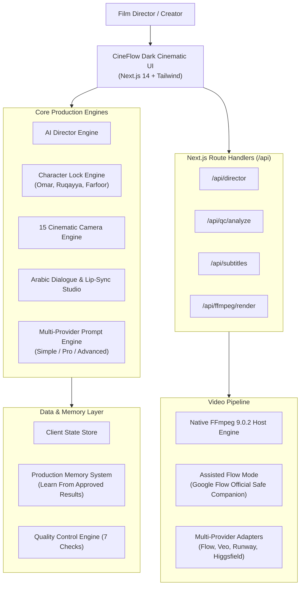

# CineFlow AI Studio — Ultimate AI Filmmaking Platform

> **الشعار:** «من الفكرة إلى فيلم سينمائي متكامل بالذكاء الاصطناعي»  
> **Tagline:** *From Idea to Complete Cinematic Film with Artificial Intelligence*

[](https://github.com/cineflow/cineflow-studio/actions/workflows/ci.yml)
[](https://nodejs.org/)
[](https://nextjs.org/)
[](https://ffmpeg.org/)
[](#license)

---

## 1. Project Overview & Features

**CineFlow AI Studio** is a professional-grade web studio that orchestrates end-to-end AI video production, character locking, screenplay direction, Arabic dialogue writing, and server-side video rendering. It is purpose-built for producing high-retention short films, children's animated stories, educational content, commercials, YouTube Shorts, and TikTok/Reels.

### Key Capabilities
- **AI Director (المخرج الذكي):** Transforms short creative concepts into complete 10-part production bundles (catchy title, synopsis, screenplay, scene breakdowns, character expressions, camera motions, SFX cues, video prompts, and publishing plan).
- **Character Lock Engine (تثبيت الشخصيات الدائم):** Permanent character library maintaining visual consistency for core characters (**عمر**, **رقية**, **فرفور**) with reference image comparison and strict negative constraints (e.g. Ruqayya's green hijab covering hair completely, Omar's Omani dishdasha and kammah).
- **Smart Storyboard (الاستوري بورد الذكي):** Interactive grid and visual timeline with multi-version generation, lighting control, camera angle selection, and direct one-click video task dispatch.
- **Arabic Dialogue Studio (استوديو الحوار العربي):** Modern Standard Arabic and Omani dialect support, unvocalized text by default, speech pacing calculator (~0.36s/word) with automatic shortening suggestions, lip-sync cue generation, and Web Speech API audio preview.
- **Cinematic Camera Engine (محرك الكاميرا السينمائية):** 15 Hollywood camera movements (Crash Zoom, Dolly In/Out, Orbit, Tracking, Dutch Angle, Crane, Bullet Time, Handheld) with automatic dramatic mood matching.
- **Prompt Engineering Engine (مولد البرومبتات):** Three distinct directorial modes:
  - **Simple Mode (Default):** Concise and punchy prompt proven in production to preserve Omar and Ruqayya's authentic attire without visual distortions.
  - **Professional Mode:** Balanced cinematography, lighting, and volumetric depth.
  - **Advanced Mode:** Technical camera rig parameters, temporal consistency tags, and weighted negative constraints.
- **Assisted Google Flow Mode (الوضع المساعد):** Fully compliant companion mode for Google Flow. Prepares all prompt parameters and reference assets for single-click copy and launches the official platform safely without credential scraping or TOS violation.
- **Video Editing Studio (استوديو المونتاج - FFmpeg):** Multi-track timeline (Video, Dialogue, SFX/BGM) with real server-side rendering powered by FFmpeg 9.0.2 exporting MP4s in 16:9, 9:16, or 1:1.
- **Production Memory (ذاكرة الإنتاج الدائمة):** Permanent experience log featuring *Learn From Approved Results* to store winning directorial setups for future productions.
- **YouTube Publishing Studio (استوديو النشر واليوتيوب):** High-CTR viral title suggestions, timestamped chapter descriptions, SEO tags, and 16:9 thumbnail concept preview.

---

## 2. Technology Stack

- **Frontend & App Framework:** Next.js 14 (App Router), React 18, TypeScript 5.7
- **Styling & UI:** Tailwind CSS, Lucide React Icons, Dark Cinematic Premium theme
- **Typography:** Cairo font family (Arabic primary), JetBrains Mono (monospace tokens)
- **Video Processing Engine:** Server-Side native FFmpeg 9.0.2 with H.264 / AAC encoding
- **State Management & Persistence:** Centralized Reactive Store with persistent LocalStorage and server sync
- **Internationalization:** Native dual layout support (RTL Arabic primary, LTR English toggle)
- **Mobile Support:** Progressive Web App (PWA) manifest and responsive layouts

---

## 3. System Architecture



---

## 4. Installation Requirements

1. **Node.js:** v18.18.0 or higher (v20+ or v22+ LTS recommended)
2. **NPM / Yarn / PNPM:** npm v9+ or npm v10+
3. **FFmpeg:** FFmpeg 5.x, 6.x, 7.x, 8.x, or 9.x installed and accessible in system `PATH`
   - *Windows (via winget):* `winget install --id Gyan.FFmpeg -e`
   - *macOS (via brew):* `brew install ffmpeg`
   - *Ubuntu/Debian:* `sudo apt update && sudo apt install -y ffmpeg`

---

## 5. Local Development Instructions

### Clone & Install
```bash
# Clone the repository
git clone https://github.com/your-org/cineflow-studio.git
cd cineflow-studio

# Install dependencies
npm install
```

### Environment Setup
```bash
# Copy template configuration
cp .env.example .env.local
```
Review `.env.local` and set any desired optional credentials (leave blank to run in fully offline / assisted mode).

### Start Development Server
```bash
npm run dev
```
Open your browser at: **`http://localhost:3000`**

---

## 6. Environment Configuration

All environment variables are declared in `.env.example`:

| Variable | Description | Default |
| :--- | :--- | :--- |
| `NEXT_PUBLIC_APP_NAME` | Visible Studio Application Name | `CineFlow AI Studio` |
| `NEXT_PUBLIC_DEFAULT_LOCALE` | Default UI Direction / Language | `ar` (Arabic RTL) |
| `FFMPEG_PATH` | Path to executable FFmpeg binary | `ffmpeg` (system PATH) |
| `NEXTAUTH_SECRET` | Secret key for session hashing | 32+ char random string |
| `GOOGLE_CLIENT_ID` | Optional Google OAuth 2.0 Client ID | Empty |
| `RUNWAY_API_KEY` | Optional Runway Gen-3 API key | Empty |
| `HIGGSFIELD_API_KEY` | Optional Higgsfield API key | Empty |

---

## 7. Available Integrations

1. **Google Flow (Assisted Mode):**
   - No unofficial scraping or token extraction.
   - Prepares prompt parameters, character locks, and camera specs for 1-click copy into `https://labs.google/flow`.
2. **Google Veo / Vertex AI:**
   - Supported through standard GCP Service Account credentials in `.env.local`.
3. **Runway Gen-3 Alpha:**
   - Supported via standard server-side bearer token authentication.
4. **Higgsfield & Kling AI:**
   - Provider adapters ready for official API keys.
5. **YouTube Publishing:**
   - Formats complete release package (Title, Chapters description, Tags, Thumbnail concept, and `.srt`/`.vtt` subtitles) ready for creator upload or YouTube Data API v3 automation.

---

## 8. Running Automated Tests

```bash
# Run unit & API test suite
npm test

# Run tests in watch mode
npm run test:watch

# Run test coverage report
npm run test:coverage
```

---

## 9. Building for Production

```bash
# Build production bundle
npm run build

# Start production server
npm run start
```
The application will launch on `http://localhost:3000` with optimized code splitting, static pre-rendering, and security headers.

---

## 10. Deployment Instructions

### Docker Deployment
```dockerfile
FROM node:20-alpine AS builder
RUN apk add --no-cache ffmpeg
WORKDIR /app
COPY package*.json ./
RUN npm ci
COPY . .
RUN npm run build

FROM node:20-alpine AS runner
RUN apk add --no-cache ffmpeg
WORKDIR /app
ENV NODE_ENV=production
COPY --from=builder /app/public ./public
COPY --from=builder /app/.next/standalone ./
COPY --from=builder /app/.next/static ./.next/static
EXPOSE 3000
CMD ["node", "server.js"]
```

### Vercel / Cloud Run / VPS
- **Serverless (Vercel):** Frontend and non-FFmpeg API routes run natively. For long-running video stitching, point `FFMPEG_PATH` to a dedicated container worker or cloud render service.
- **Dedicated VPS (Ubuntu / Debian / Windows Server):** Full native FFmpeg support out of the box with `npm run start` managed by PM2 or systemd.

---

## 11. Troubleshooting Guide

- **`ffmpeg: command not found`:**
  - Verify FFmpeg is installed by running `ffmpeg -version`. Ensure the directory containing `ffmpeg.exe` is added to your system `PATH`.
- **Arabic text rendering in FFmpeg overlays:**
  - FFmpeg synthetic renders use vector boxes and standard typography. Ensure system font packages are installed for custom font files.
- **Web Speech API TTS not speaking:**
  - Web Speech synthesis requires user interaction (clicking the audio preview button) to comply with browser autoplay policies. Ensure an Arabic voice pack is available on your OS.

---

## 12. Security Policy

Please review [SECURITY.md](SECURITY.md) for vulnerability disclosure procedures and security guarantees.

---

## 13. License & Authorship

Developed for **CineFlow AI Studio** — All rights reserved © 2026.
